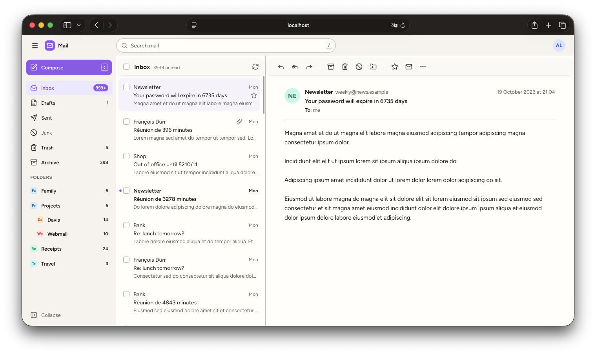
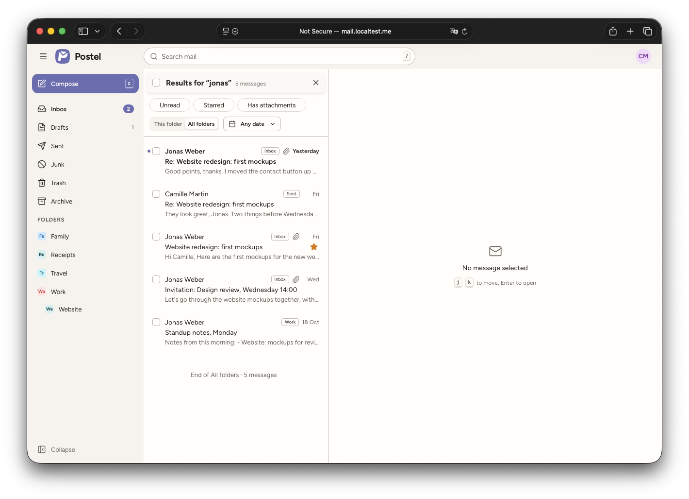
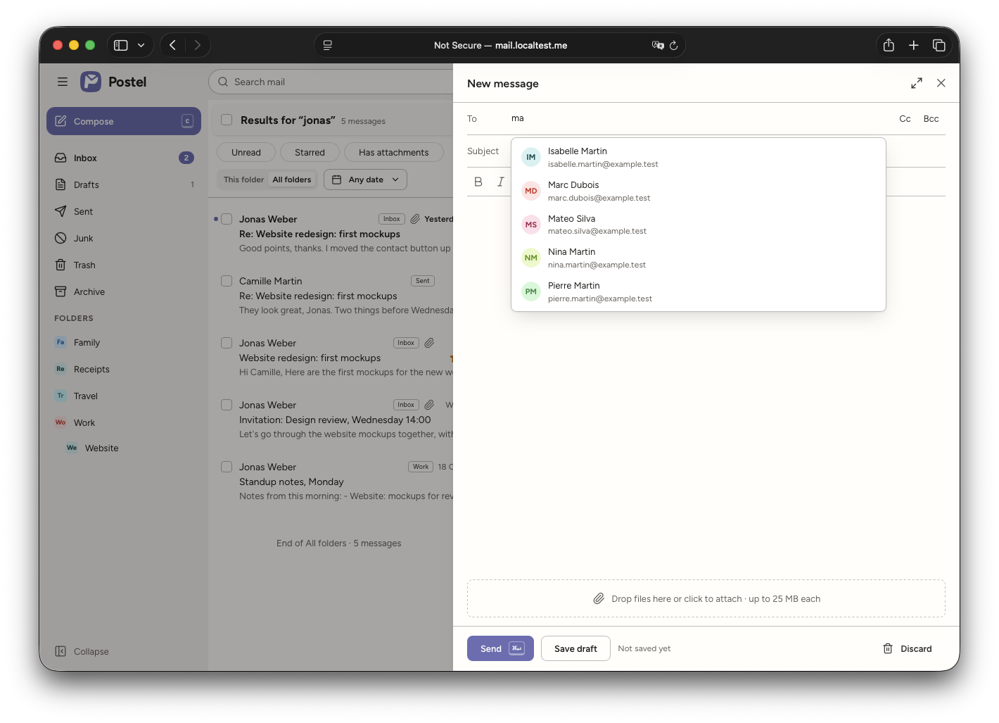
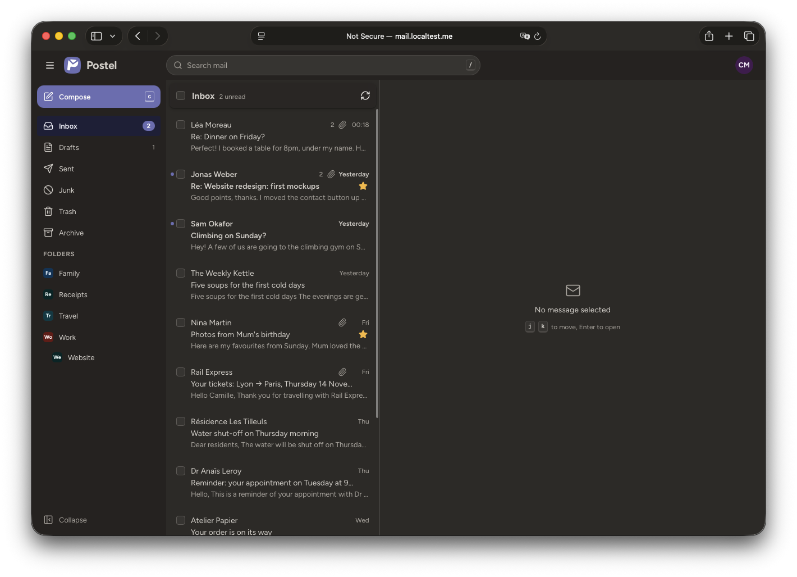
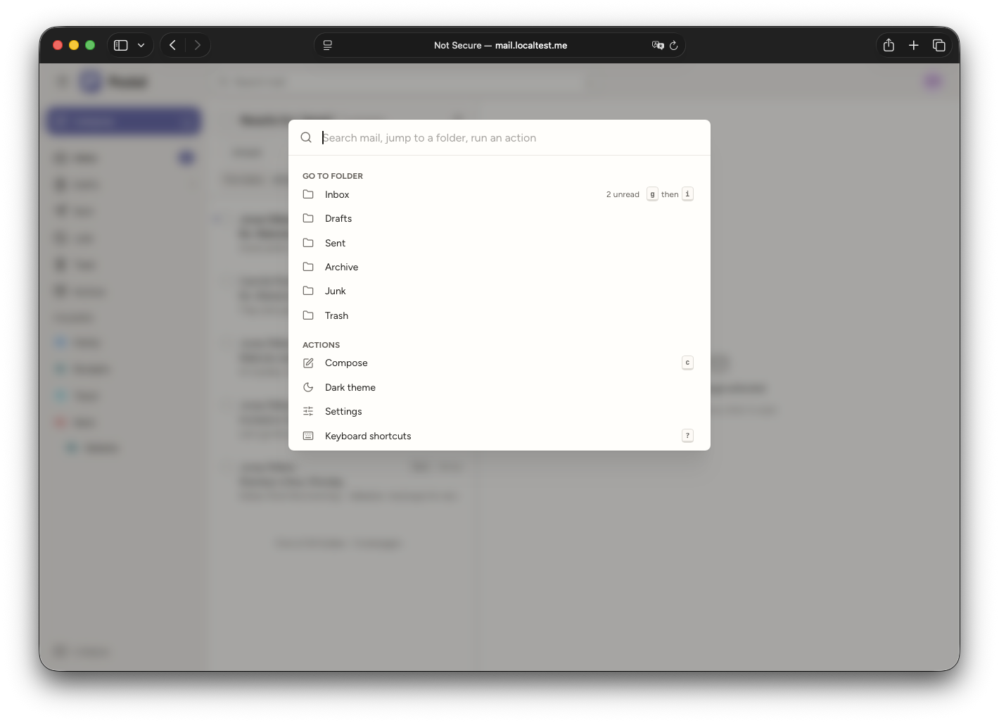

Postel
---

[](https://github.com/tchapi/postel/actions/workflows/ci.yml)
[](https://github.com/tchapi/postel/actions/workflows/publish.yml)
[](https://github.com/tchapi/postel/releases)
[](https://github.com/tchapi/postel/blob/main/LICENSE)


[](https://paypal.me/tchap)

A modern, simple, self-hosted webmail for the mail server you already run, built with [Symfony 7](https://symfony.com/) and [React](https://react.dev/) with [Mantine](https://mantine.dev/).

It sits behind your single sign-on (such as [Authelia](https://www.authelia.com/)) and reads your mailbox with a Dovecot master user, so it never asks for, or stores, anyone's mail password.

### Reading and organising mail

- Folders with unread counts, a fast message list that stays fast on large mailboxes, and conversations (grouped on the server, can be turned off)
- Mark as read or unread, star, archive, move, delete and mark as junk, one message at a time or in bulk, with undo
- Search on sender, recipients and subject, in one folder or all of them, with filters (unread, starred, with attachments, date range)
- HTML messages are cleaned on the server and shown in a sandbox. Remote images are blocked until you allow them, once or for a sender
- Attachments and inline images, and the original message source

### Writing mail

- Rich text composer with replies, reply all and forwards (attachments included)
- Drafts saved on their own as you type, and stored in your mailbox
- Undo send for a few seconds after sending
- Recipient suggestions from your [Davis](https://github.com/tchapi/davis) address books (_optional_)

### Interface

- Light and dark mode, six accent colours, two densities
- English and French
- Three panes on a large screen, two on a tablet, one on a phone, with swipe actions and pull to refresh
- Keyboard shortcuts for almost everything (press `?` to see them), and a command palette
- Settings (display name, signature, and the above) stored on the server, with import and export

### Deployment

Comes as one Docker image (php-fpm and Caddy) for `amd64` and `arm64`, with a sample `compose.yaml`. There is no database to set up: the few things it stores (your settings, the contacts cache) go in a SQLite file.

- - -

✨ Created and maintained by [@tchapi](https://github.com/tchapi). ✨





| Dark mode | Search and command palette |
|-----------|----------------------------|
|  |  |

# 🔩 Requirements

  - An IMAP server that supports master users and the `SORT`, `THREAD`, `MOVE` and `PREVIEW` extensions. [Dovecot](https://www.dovecot.org/) does, and it is the only one tested (_2.3.19, as shipped with [docker-mailserver](https://docker-mailserver.github.io/docker-mailserver/latest/) 15_)
  - An SMTP submission server that accepts the same master user. With Dovecot as the SASL backend for Postfix, which is the usual setup, it does
  - A reverse proxy doing forward-auth, which sets `Remote-User`, `Remote-Email` and `Remote-Name` on each request. For instance Traefik or Caddy with Authelia
  - [Davis](https://github.com/tchapi/davis) 5.6 or later, if you want recipient suggestions (_optional_)

To run it without Docker, you also need PHP 8.4 (with the `intl` extension), Composer 2 and Node 22 or later to build the frontend.

# 🧰 Installation

The recommended way is the Docker image, see [Dockerized installation](#-dockerized-installation) below.

Whatever the way, you need to:

1. Create a [Dovecot master user](#dovecot-master-user) for Postel
2. Put Postel behind a [reverse proxy with forward-auth](#-reverse-proxy-and-authentication)
3. Set the [configuration](#configuration)
4. Optionally, create a [Davis app key](#davis-app-key) for recipient suggestions

## Configuration

Everything is set with environment variables.

| Variable | Default | Description |
|----------|---------|-------------|
| `APP_SECRET` | | A random string, **required** |
| `TRUSTED_PROXIES` | | The address(es) of your reverse proxy, comma-separated. Only requests coming from there can say who the user is. **Required**, nobody can log in without it |
| `IMAP_HOST` | `mail` | IMAP server |
| `IMAP_PORT` | `143` | IMAP port |
| `IMAP_ENCRYPTION` | `false` | `false`, `ssl` or `tls` (_STARTTLS_) |
| `IMAP_VALIDATE_CERT` | `true` | Check the IMAP server's certificate |
| `IMAP_MASTER_USER` | `webmail` | The Dovecot master user |
| `IMAP_MASTER_PASSWORD` | | Its password, **required** |
| `IMAP_LOGIN_ATTRIBUTE` | `email` | Which header is the mailbox login: `email` (`Remote-Email`) or `username` (`Remote-User`) |
| `SMTP_HOST` | `mail` | SMTP submission server, used with the same master user |
| `SMTP_PORT` | `587` | Submission port |
| `SMTP_ENCRYPTION` | `tls` | `false`, `ssl` or `tls` (_STARTTLS_) |
| `SMTP_VALIDATE_CERT` | `true` | Check the SMTP server's certificate |
| `DAVIS_URL` | | The DAV root of your Davis server, for instance `https://dav.example.com/dav/`. Leave it empty to turn recipient suggestions off |
| `DAVIS_APP_ID` | | The Davis app key's id (`app_…`) |
| `DAVIS_APP_SECRET` | | The Davis app key's secret |
| `DAVIS_LOGIN_ATTRIBUTE` | `username` | Which header is the Davis login: `username` (`Remote-User`) or `email` (`Remote-Email`) |
| `LOGOUT_URL` | | Where "Sign out" goes, usually your identity provider's logout page. When empty, it reloads the page |
| `APP_DATA_DIR` | `/app/var/data` | Where the settings database and the attachments waiting to be sent are kept. Mount a volume there |
| `DATABASE_URL` | `sqlite:////app/var/data/postel.db` | The settings database. Any [Doctrine DSN](https://www.doctrine-project.org/projects/doctrine-dbal/en/latest/reference/configuration.html#connecting-using-a-url) works, the SQLite default is fine |

> [!NOTE]
>
> Database migrations run on their own when the container starts.

## Dovecot master user

Postel logs into Dovecot as `<user>*<master user>` with the master password, and Dovecot opens the mailbox of `<user>`. This way Postel never needs the user's own password.

With [docker-mailserver](https://docker-mailserver.github.io/docker-mailserver/latest/config/advanced/dovecot-master-accounts/):

```sh
docker exec mailserver setup dovecot-master add webmail
```

With Dovecot on its own, see [master users](https://doc.dovecot.org/configuration_manual/authentication/master_users/).

> [!CAUTION]
>
> The master password opens every mailbox on the server. Keep it out of anything a browser can reach, and make sure the Postel container can only be reached through your reverse proxy.

The `<user>` part comes from the forward-auth headers: the email (`Remote-Email`) by default, or the username (`Remote-User`) with `IMAP_LOGIN_ATTRIBUTE=username`. It has to match the mailbox login exactly.

## Davis app key

Recipient suggestions come from the user's [Davis](https://github.com/tchapi/davis) address books, read with an app key: Postel logs in as `<user>*<app id>` with the key's secret, and Davis acts as `<user>`. It needs Davis 5.6 or later.

1. Turn app keys on in Davis with `APP_KEYS_ENABLED=true`
2. Create a key, for all users or only the ones using Postel:

```sh
docker exec davis bin/console davis:app-key:create postel --all-users
# or
docker exec davis bin/console davis:app-key:create postel --user alice --user bob
```

_The **App keys** page of the Davis dashboard does the same._

3. Set `DAVIS_URL`, `DAVIS_APP_ID` and `DAVIS_APP_SECRET` on Postel

> [!NOTE]
>
> Davis never creates an account for an app key: each user needs an existing Davis account with the same name. Users without one simply get no suggestions.
>
> `--all-users` does not include Davis admins. If an admin uses Postel, add them with `--user`.

Postel keeps a copy of the names and addresses in its SQLite file, and checks Davis for changes at most every five minutes. Suggestions never wait for Davis.

# 🌐 Reverse proxy and authentication

Postel has no login page. It relies on a reverse proxy that checks the user with an identity provider (forward-auth), and passes these headers on each request:

  - `Remote-User`: the username
  - `Remote-Email`: the email address
  - `Remote-Name`: the display name (_optional_)

Postel only trusts these headers when the request comes from an address in `TRUSTED_PROXIES`. When the identity provider's session ends, Postel gets a `401` on its next request and reloads the page, which brings the login page back.

> [!IMPORTANT]
>
> Set `TRUSTED_PROXIES` to your reverse proxy's address only, and don't publish Postel's port. Anything that can reach the container from a trusted address can choose who it is.

## Traefik and Authelia

On the Authelia container:

```yaml
labels:
  - "traefik.http.middlewares.authelia.forwardauth.address=http://authelia:9091/api/authz/forward-auth"
  - "traefik.http.middlewares.authelia.forwardauth.trustForwardHeader=true"
  - "traefik.http.middlewares.authelia.forwardauth.authResponseHeaders=Remote-User,Remote-Groups,Remote-Name,Remote-Email"
```

On the Postel container:

```yaml
labels:
  - "traefik.enable=true"
  - "traefik.http.routers.postel.rule=Host(`mail.example.com`)"
  - "traefik.http.routers.postel.entrypoints=websecure"
  - "traefik.http.routers.postel.tls.certresolver=default"
  - "traefik.http.routers.postel.middlewares=authelia@docker"
  - "traefik.http.services.postel.loadbalancer.server.port=8080"
```

> [!TIP]
>
> To know Traefik's address for `TRUSTED_PROXIES`, give it a fixed one on the network it shares with Postel. If Postel is on several networks with Traefik, tell Traefik which one to use with the `traefik.docker.network` label, otherwise it picks one at random and the requests may not come from the address you trust.

## Caddy and Authelia

```
mail.example.com {
    forward_auth authelia:9091 {
        uri /api/authz/forward-auth
        copy_headers Remote-User Remote-Groups Remote-Email Remote-Name
    }
    reverse_proxy postel:8080
}
```

# 🐳 Dockerized installation

The image runs php-fpm and Caddy, and listens on port `8080`. TLS is left to your reverse proxy.

```sh
docker run -d --name postel \
  -e APP_SECRET=change-me \
  -e TRUSTED_PROXIES=172.18.0.2 \
  -e IMAP_HOST=mail \
  -e IMAP_MASTER_PASSWORD=the-master-password \
  -e SMTP_HOST=mail \
  -e LOGOUT_URL=https://auth.example.com/logout \
  -v postel-data:/app/var/data \
  ghcr.io/tchapi/postel:1.0.0
```

A sample [`compose.yaml`](compose.yaml) is also included. It reads the variables from a `.env` file next to it.

To build the image yourself, from the checked out version:

```sh
docker build --tag postel:latest .
```

## Docker images

For each release, an image is built for `amd64` and `arm64` and published in the [GitHub package repository](https://github.com/tchapi/postel/pkgs/container/webmail).

### Release images

Each release is tagged with its version, its minor version, its major version, and `latest`:

```
docker pull ghcr.io/tchapi/postel:1.0.0
docker pull ghcr.io/tchapi/postel:1.0
docker pull ghcr.io/tchapi/postel:1
```

### Edge image

The edge image is built from the tip of the main branch, on demand:

```
docker pull ghcr.io/tchapi/postel:edge
```

> [!WARNING]
>
> The `edge` image must not be considered stable. **Use only release images for production setups**.

## Updating from a previous version

Pull the new image and recreate the container. Migrations run on their own when it starts.

# Development

The backend is in `backend/` and the frontend in `frontend/`.

Backend (PHP 8.4 and Composer 2):

```sh
cd backend
composer install
PHP_CLI_SERVER_WORKERS=4 php -S 127.0.0.1:8000 -t public
```

Frontend (Node 22 or later):

```sh
cd frontend
npm install
npm run dev
```

The frontend runs on http://localhost:5173 and passes `/api` to the backend on port `8000`. There is no identity provider in development, so the frontend's dev server sets the identity headers itself (`alice` by default, see `frontend/.env.example`).

## A mail server and a Davis for development

A throwaway mail server, with a test account, a master user and a mailbox filled with generated messages (_Docker required_):

```sh
docker compose -f dev/mailserver/compose.yaml up -d
cd backend && php bin/console app:dev:seed-mailbox --count=2000
```

A throwaway Davis, with 300 contacts for `alice` and an app key for Postel:

```sh
docker compose -f dev/davis/compose.yaml up -d
docker exec -u www-data postel-dev-davis sh -c 'cd /var/www/davis && APP_ENV=prod bin/console doctrine:migrations:migrate --no-interaction'
dev/davis/seed.sh
docker exec -u www-data postel-dev-davis sh -c 'cd /var/www/davis && APP_ENV=prod bin/console davis:app-key:create postel --all-users'
```

Then point the backend at them in `backend/.env.local`:

```sh
IMAP_HOST=127.0.0.1
IMAP_PORT=1143
IMAP_MASTER_PASSWORD=master-password
SMTP_HOST=127.0.0.1
SMTP_PORT=1587
SMTP_ENCRYPTION=false
DAVIS_URL=http://127.0.0.1:9000/dav/
DAVIS_APP_ID=app_...
DAVIS_APP_SECRET=...
```

> [!NOTE]
>
> In development, the local address is a trusted proxy, so you can call the API as any user with the headers:
>
>     curl -H 'Remote-User: alice' -H 'Remote-Email: alice@example.test' http://127.0.0.1:8000/api/folders

## The full stack, locally

To try the production image behind Traefik and Authelia, on top of the development mail server and Davis:

```sh
DAVIS_APP_ID=app_... DAVIS_APP_SECRET=... docker compose -f dev/stack/compose.yaml up -d --build
```

Then open https://mail.localtest.me:8443 (_with a self-signed certificate_) and log in as `alice` / `alice-password`. The Davis dashboard is at https://dav.localtest.me:8443, behind the same login.

## Testing

```sh
cd backend && composer test
cd frontend && npm test
```

The backend tests that need a mail server use the development one, and are skipped when it is not running.

## ✨ Code linting

Backend, with [PHP-CS-Fixer](https://github.com/PHP-CS-Fixer/PHP-CS-Fixer) and [PHPStan](https://phpstan.org/):

```sh
cd backend && composer lint && composer stan
```

_`composer lint:fix` fixes the formatting._

Frontend, with [Prettier](https://prettier.io/), [Oxlint](https://oxc.rs/) and TypeScript:

```sh
cd frontend && npm run format && npm run lint && npm run typecheck
```

_`npm run format:fix` fixes the formatting._

How the parts fit together is explained in [docs/architecture.md](docs/architecture.md).

# 🐛 Troubleshooting

### Logs

The container prints everything on its standard output: `docker logs postel`.

### Every request gets a `401`

Postel does not trust the request's identity headers. Check that:

  - `TRUSTED_PROXIES` has the address the requests really come from, which is the reverse proxy's address on the network it shares with Postel
  - with Traefik, when Postel is on several networks with it, the `traefik.docker.network` label names the right one
  - the forward-auth passes `Remote-User` and `Remote-Email`

### "Couldn't load messages", and `Maximum number of connections from user+IP exceeded` in the logs

Dovecot limits the number of connections per user and IP address (`mail_max_userip_connections`, 10 by default), and all Postel's connections come from the container's address. Many tabs or devices open at once can reach it. Raise the limit in Dovecot's configuration if needed.

### The mailbox does not open: `Authentication failed`

  - Check the master user and its password
  - Check that the user part is the mailbox login: the email by default, or the username with `IMAP_LOGIN_ATTRIBUTE=username`

### No recipient suggestions

  - `DAVIS_URL`, `DAVIS_APP_ID` and `DAVIS_APP_SECRET` must all be set
  - Davis must be 5.6 or later, with `APP_KEYS_ENABLED=true`
  - The key's scope must include the user, and the user must have a Davis account with the same name (_see `DAVIS_LOGIN_ATTRIBUTE`_)
  - The logs show `Contacts: Davis unavailable` with the reason when Davis refuses the key or does not answer

### An attachment is refused

Each file can be up to 25 MB. The whole message also has to fit within your SMTP server's size limit (_`message_size_limit` in Postfix_).

# 📚 Libraries used

  - Symfony 7 (Licence : MIT)
  - Doctrine (Licence : MIT)
  - webklex/php-imap (Licence : MIT)
  - zbateson/mail-mime-parser (Licence : BSD-2-Clause)
  - React 19 (Licence : MIT)
  - Mantine 9 (Licence : MIT)
  - TanStack Query and TanStack Virtual (Licence : MIT)
  - Tiptap (Licence : MIT)
  - Lucide icons (Licence : ISC)
  - Figtree font (Licence : OFL-1.1)

# ⚖️ Licence

This project is released under the MIT licence. See the [LICENSE](LICENSE) file.
